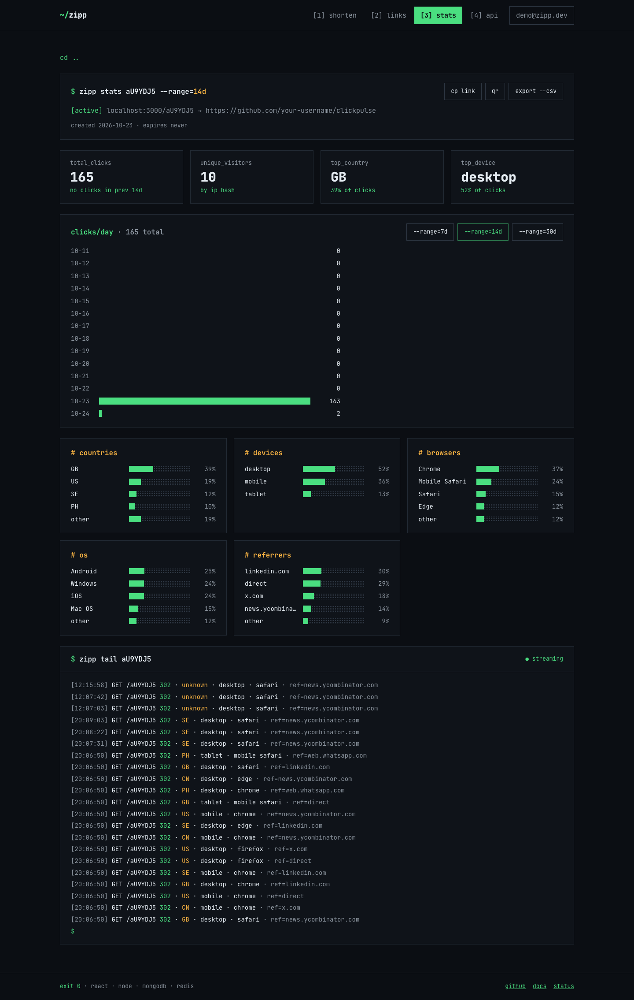
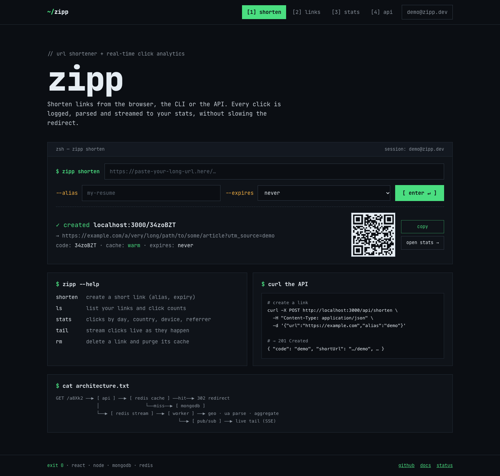
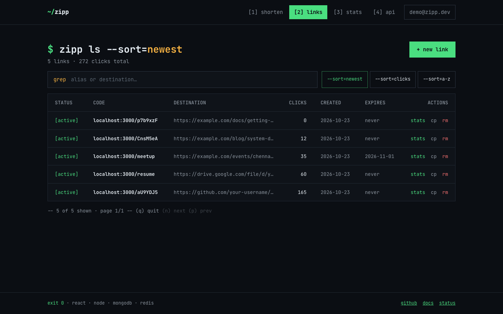
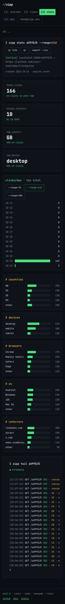
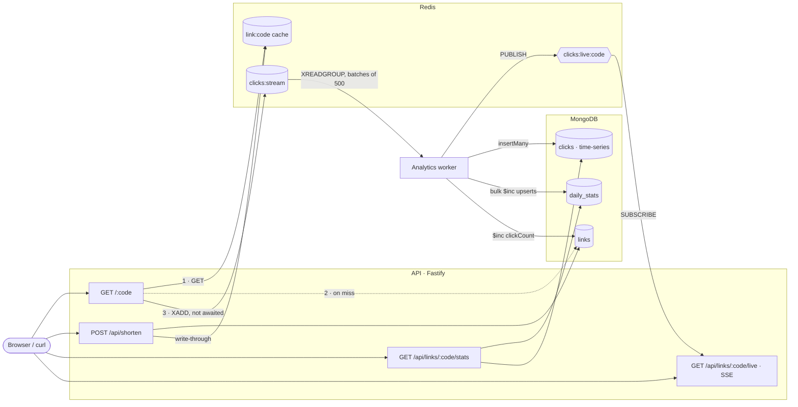
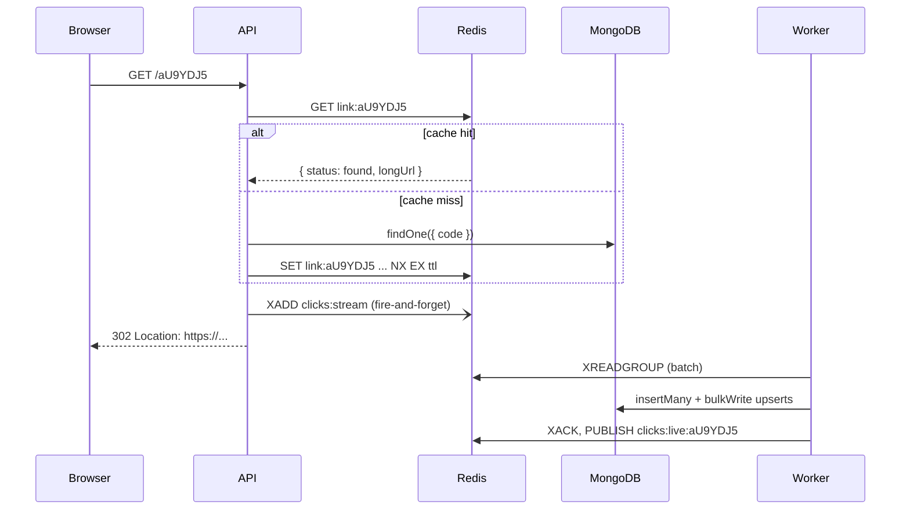

# Zipp

A URL shortener with real-time click analytics, built to explore system design: a cached redirect path with no database writes, collision-free short codes without "does it exist?" checks, an asynchronous analytics pipeline, and load-test numbers to back it up.

**Stack:** Node.js 24 · TypeScript · Fastify · MongoDB 8.2 · Redis 8.2 (cache, rate limiting, Streams, Pub/Sub) · React 19 + Vite · Vitest · k6 · Docker · GitHub Actions

| | With Redis cache | MongoDB only |
|---|---|---|
| Redirect throughput (1 API process) | **17,243 req/s** | 6,444 req/s |
| Redirect p99 at a steady 2,000 req/s | **5.2 ms** | 152 ms |
| Cache hit rate (steady state) | 99.8% | — |

<sub>Median of 3 runs on an Apple M4 laptop, everything in Docker. Methodology, ranges and caveats are in [Load testing](#load-testing).</sub>



<details>
<summary>More screenshots</summary>

| Shorten | My links | Phone |
|---|---|---|
|  |  |  |

</details>

## Contents

- [Features](#features)
- [Architecture](#architecture)
- [Design decisions](#design-decisions)
- [Load testing](#load-testing)
- [Running it locally](#running-it-locally)
- [Testing and CI](#testing-and-ci)
- [API](#api)
- [Project structure](#project-structure)
- [Known limitations and how to scale further](#known-limitations-and-how-to-scale-further)

## Features

- **Short links:** generated 7-character codes or custom aliases, optional expiry (`410 Gone` once expired), delete.
- **Fast redirects:** Redis cache-aside with negative caching; the redirect path never writes to MongoDB.
- **Click analytics:** every redirect is queued on a Redis Stream; a separate worker parses the user agent, resolves the country (GeoLite2), and writes raw clicks to a time-series collection plus pre-aggregated daily counters.
- **Dashboard:** clicks per day, countries, devices, browsers, OS, referrers, unique visitors, change vs the previous period, CSV export, QR codes, and a **live tail** of clicks over Server-Sent Events.
- **Accounts:** email + password, Redis-backed sessions. Links created while logged in are private to their owner; guest links get a one-time manage token for deletion.
- **Production basics:** rate limiting, input validation, structured logs, central error handling, health checks, graceful shutdown, 138 tests, CI, one-command Docker setup.

## Architecture



**The redirect path** is one Redis `GET` (MongoDB only on a cache miss), then a `302`. Recording the click is a single `XADD` that the response doesn't wait for. Parsing, geo lookup and every database write happen later in the worker.



Two processes run from one Docker image: the **API** (`node dist/server.js`) and the **worker** (`node dist/worker.js`). They share code but scale independently.

## Design decisions

### Short codes: counter ranges + Base62, not random strings

The usual approach generates a random string and checks the database for a collision, which costs a read on every create and gets slower as the keyspace fills. Instead, each code comes from a unique number:

1. **Range reservation.** A `counters` document holds the next free ID. Each API instance atomically reserves 1,000 IDs with `findOneAndUpdate({ _id: 'link_id' }, { $inc: { seq: 1000 } })` and hands them out from memory. A single-document update is atomic in MongoDB, so two instances can never get overlapping ranges, and creating 1,000 links costs one database round-trip instead of 1,000. Concurrent requests on an empty range share one in-flight reservation ([`id-allocator.ts`](src/services/id-allocator.ts)).
2. **Base62** (`0-9A-Za-z`) turns the number into a URL-safe string; 7 characters give 62⁷ ≈ 3.5 trillion codes.
3. **Scrambling.** Sequential IDs would produce sequential codes, letting anyone enumerate every link. The ID is first mapped through `(id × A + B) mod 62⁷`. Because `A` shares no prime factor with 62⁷ (62 = 2 × 31), this is a bijection: still no collisions, but consecutive IDs give unrelated-looking codes (`0 → LjaL3EZ`, `1 → y3J8vZe`). This is obfuscation, not security, since a few known (id, code) pairs reveal the constants.

**Tradeoffs.** IDs have gaps: when an instance restarts, the rest of its range is never used. Each instance's codes come from its own block of numbers. The counter document is a single write hot spot, but it's touched once per 1,000 links.

**Custom aliases can never collide with generated codes:** generated codes are always exactly 7 alphanumeric characters, and aliases with exactly that shape are rejected (`abc1234` ✗, `abc-123` ✓). The two sets are disjoint by construction, and the unique index on `code` is the safety net. A test checks this property, along with the coprimality that makes scrambling safe.

### Cache strategy

Redis holds one key per code, `link:{code}`, whose value is `found` (with the URL and expiry), `notFound`, or `expired` ([`link-cache.ts`](src/services/link-cache.ts)).

- **Cache-aside on reads:** check Redis, and on a miss read MongoDB and fill the cache.
- **Write-through on create:** new links are usually clicked right away, so they're cached immediately.
- **Negative caching:** "not found" and "expired" are cached for 60s, so a bot trying random codes can't push every request through to MongoDB.
- **TTL:** 24 hours, but never past the link's own expiry, so the cache can't keep redirecting an expired link.
- **The invalidation race, and how it's closed.** Classic cache-aside has a race: a redirect reads MongoDB, the link is deleted, then the redirect writes the stale entry back. Here, create and delete *overwrite* the entry (`SET`), while filling after a miss uses `SET NX`, which can never overwrite them. Delete writes a `notFound` tombstone instead of removing the key.
- **Redis down? Fail open.** Commands fail immediately instead of queueing (`enableOfflineQueue: false`). The cache falls back to MongoDB and the rate limiter lets requests through, so an outage costs speed, not availability. (Tested: with Redis stopped, redirects still return 302.)
- **Eviction:** `maxmemory-policy volatile-lru` evicts only keys with a TTL (cache entries, rate-limit windows), never the click stream.

### 302, not 301

A `301 Moved Permanently` is cached by browsers, which then skip the shortener on later visits. Those clicks would never be counted, and the link could never be changed, expired or deleted for anyone who had already visited. `302 Found` sends every click through the server. `Cache-Control: private, max-age=0` also stops CDNs and proxies from caching the redirect. The cost is a round-trip to the shortener on every click, which is the point of an analytics product.

### Async analytics: Redis Streams + a separate worker

The redirect only does an `XADD` (O(1), not awaited). A separate worker process does the slow work ([`click-consumer.ts`](src/workers/click-consumer.ts)):

- **Why Streams over BullMQ:** one command per click on the hot path (BullMQ uses several per job), and natural batching: the worker reads up to 500 events with one `XREADGROUP`. Batching is the main performance lever: 500 clicks on a viral link become **one** `$inc` upsert into `daily_stats` plus one `insertMany`, not 1,000 writes.
- **Consumer groups:** run N workers in one group and each message goes to exactly one of them. A message stays *pending* until `XACK`. If a worker crashes mid-batch, another claims its messages with `XAUTOCLAIM` after 60s.
- **At-least-once delivery.** If a worker crashes after writing to MongoDB but before `XACK`, that batch is counted twice. The window is two back-to-back calls; closing it fully would need a MongoDB transaction recording processed message IDs with the counters.
- **Poison messages:** a malformed message would fail forever, so it is copied to a dead-letter stream (`clicks:dead`) and acked. Temporary failures (MongoDB down) are left pending and retried.
- **Backpressure:** if workers fall behind, the stream grows, up to `MAXLEN ~ 1,000,000`, after which the oldest unprocessed clicks are dropped, a deliberate choice of losing some analytics over running Redis out of memory. Redis uses `appendonly` with `fsync` every second, so queued clicks survive a restart.

The worker enriches each click: user agent → device, browser and OS (`ua-parser-js`); IP → country (MaxMind GeoLite2, behind a `GeoLookup` interface so tests use a fake); referrer → host only. The IP is stored as an **HMAC** (a plain SHA-256 of an IPv4 address can be reversed by hashing all 4 billion of them).

**Two storage shapes for two kinds of question:**

- `clicks`: a **time-series collection** of raw events (90-day TTL). MongoDB groups clicks for the same link into compressed buckets. Used for questions that need individual events: unique visitors, the live tail's history.
- `daily_stats`: one document per link per day, with counters per country, device, browser, OS and referrer, updated with `$inc` upserts. The dashboard reads at most `days` small documents however many clicks a link has had, and merges them with one aggregation pipeline (`$facet` → `$objectToArray` → `$unwind` → `$group`). Dots in keys like `google.com` are swapped for a full-width lookalike, because MongoDB would read `referrers.google.com` as a nested path.

**Live tail:** after each batch, the worker publishes clicks to Redis Pub/Sub (`clicks:live:<code>`). Each API instance keeps one subscriber connection, subscribes only to links someone is watching, and streams to browsers over **Server-Sent Events** (one-way, plain HTTP, automatic reconnection). Pub/Sub drops messages nobody is subscribed to, which is fine for a live view; the history comes from MongoDB on connect.

### Why MongoDB, and what it costs compared with SQL

**What it gives this project:**

- **Document model:** a link, or a day of stats with its nested counter maps, is one document, so a lookup is one read with no joins. Atomic `$inc` upserts on nested fields fit the counters well.
- **TTL indexes:** expired links delete themselves (`expireAfterSeconds: 0` on `expiresAt`). The background job runs about once a minute, so the app still checks expiry and returns `410` in that window.
- **Time-series collections:** built-in columnar compression and bucketing for timestamped events, plus TTL retention.
- **Horizontal scaling:** every hot query is by `code`. Sharding `links` on `{ code: 'hashed' }` spreads data evenly and keeps each redirect lookup on a single shard.

**What you lose compared with PostgreSQL:**

- No foreign keys: `links.ownerId` is not enforced, so deleting a user would leave orphaned links unless the app cleans up.
- Multi-document transactions need a replica set and cost more. That's part of why the analytics pipeline is at-least-once rather than exactly-once.
- Schemas are enforced in the application (Fastify JSON Schema, TypeScript), not by the database.
- Ad-hoc analytics are more verbose: an aggregation pipeline instead of SQL with `GROUP BY`, window functions and `COUNT(DISTINCT ...)`.
- Unique indexes on a sharded collection must include the shard key, so `users.email` uniqueness constrains how `users` could be sharded.

The official `mongodb` driver is used rather than Mongoose: this project leans on driver-level features (atomic `findOneAndUpdate`, time-series collection creation, `bulkWrite` upserts, aggregation pipelines), and Mongoose's document hydration would add overhead to the hot path while duplicating validation that already happens at the API edge.

### Rate limiting

A **sliding-window log** in a Redis sorted set, checked by one Lua script ([`rate-limiter.ts`](src/services/rate-limiter.ts)): link creation is limited to 10/min per IP plus a global 1,000/min ceiling, and login/register to 10/min per IP.

- **Lua for atomicity:** "count, then add" as two commands would let two API instances both see 9 and both allow the 10th request.
- **Redis's clock** (`TIME`), so instances with skewed clocks agree.
- **All-or-nothing:** a request rejected by the global limit doesn't use up the client's per-IP quota.
- **Runs in `onRequest`,** before the body is parsed, so junk requests count too and are cheap to reject.
- **Tradeoff vs a sliding-window counter:** exact, but memory grows with the limit (fine at 10/min); the counter version uses constant memory but is approximate.
- **Fails open** if Redis is down.

### Accounts and sessions

Passwords are hashed with Node's built-in **scrypt** (N=2¹⁴, r=8, p=5, one of OWASP's recommended settings), with a random salt per user and the parameters stored with each hash so they can be raised later. Login hashes even when the email doesn't exist, and gives the same message, so response time doesn't reveal which emails have accounts.

Sessions are **opaque random IDs in Redis** (7-day TTL), not JWTs, so logout really revokes them. Redis stores only a SHA-256 of each session ID. The cookie is `HttpOnly` (XSS can't read it), `SameSite=Lax` (blocks cross-site POST/DELETE, i.e. CSRF), and `Secure` over HTTPS. Sessions are only loaded for `/api/` routes, so the redirect path never pays for a session lookup.

## Load testing

### Setup

- **Hardware:** one Apple M4 laptop (10 cores, 16 GB). API, worker, MongoDB, Redis **and the load generator** all run in Docker Desktop's VM (10 CPUs, 7.7 GB), so they compete for the same CPUs. Treat the numbers as relative (cache vs no cache), not as a production capacity claim.
- **Tool:** [k6](https://k6.io) 2.3.0, running in a container on the Docker network, so traffic skips the Mac's port forwarding.
- **Topology:** **one** API process (Node.js runs your code on a single thread) and one worker.
- **Data:** 5,000 links. The traffic mix is 95% real links (80% of those go to the hottest 20% of links) and 5% requests for unknown codes, which exercises negative caching.
- **Config for the run:** info-level request logs off (`LOG_LEVEL=warn`) and rate limits raised, via [`compose.loadtest.yml`](load-tests/compose.loadtest.yml).

### Methodology

- **Two kinds of run:**
  - **Throughput:** 64 virtual users with no pauses (a *closed* model) find the maximum req/s.
  - **Latency:** a *fixed arrival rate* of 2,000 req/s (an *open* model). Measuring latency at saturation mostly measures queueing. A fixed rate also keeps sending on schedule when the server slows down, where a fixed set of users would slow down with it and hide the problem.
- **Cold start, recorded separately:** after each API restart, a 10-second run starts from a cold process (and a cold cache when caching is on). It's reported as its own row instead of being mixed into the steady state.
- **Repeats:** each scenario runs 3 times. The table shows the median run by p99, plus the ranges.
- **Independent runs:** before the next run starts, the worker drains every queued click.

Run it yourself with `load-tests/run.sh` (about 15 minutes). Raw per-run JSON is in [`load-tests/results/`](load-tests/results/).

### Results

| Test | Load | Throughput (req/s) | Throughput range | p50 (ms) | p95 (ms) | p99 (ms) | p99 range (ms) | Cache hit rate | Errors |
|---|---|---|---|---|---|---|---|---|---|
| Redirect, **cache**, cold start | 2,000 req/s, first 10s | 2,000 | — | 0.18 | 1.40 | 27.6 | — | 82.3% | 0% |
| Redirect, **cache** | max (64 VUs) | **17,243** | 15,145–27,611 | 3.13 | 6.40 | **11.3** | 7.3–12.0 | 100.0% | 0% |
| Redirect, **cache** | 2,000 req/s fixed | 2,000 | 1,998–2,000 | 0.17 | 0.51 | **5.2** | 5.1–24.5 | 99.8% | 0% |
| Redirect, no cache, cold start | 2,000 req/s, first 10s | 2,000 | — | 0.26 | 0.60 | 7.1 | — | — | 0% |
| Redirect, no cache | max (64 VUs) | 6,444 | 6,413–7,298 | 8.64 | 18.28 | 26.5 | 24.2–34.0 | — | 0% |
| Redirect, no cache | 2,000 req/s fixed | 1,983 | 1,896–1,998 | 0.41 | 16.89 | 152.2 | 46.6–977.3 | — | 0%¹ |
| Shorten (`POST /api/shorten`) | max (32 VUs) | 8,123 | — | 3.35 | 6.98 | 10.7 | — | — | 0% |

<sub>¹ No failed requests, but k6 couldn't start 509 of the scheduled requests on time because its virtual users were all waiting on slow responses.</sub>

### What the numbers show

1. **The cache roughly 2.7× the redirect throughput** (17.2k vs 6.4k req/s median) and more than halves p99 at saturation (11 ms vs 27 ms).
2. **More importantly, the cache isolates redirects from the analytics write load.** At a modest, fixed 2,000 req/s, uncached p99 was 47–977 ms, while cached p99 was about 5 ms under identical conditions. The uncached runs happened right after the worker had written hundreds of thousands of clicks into MongoDB. In a follow-up experiment, the same uncached run immediately after a write burst had p99 65 ms; after waiting 90 seconds for MongoDB to finish flushing to disk (longer than its 60-second checkpoint interval), it had p99 **3 ms**. MongoDB's slow-query log during such a run showed a plain `links.find` taking 126 ms while the worker's insert waited 155 ms on storage. Without the cache, every redirect shares the database with analytics writes, and that is visible in the tail latency. *(Small samples, so this is strong evidence rather than proof. The virtualized disk under Docker Desktop likely exaggerates the effect.)*
3. **Steady-state hit rate is about 100%** because all 5,000 links fit in the cache. A real long tail of rarely-clicked links would lower it, which is why the TTL and `volatile-lru` eviction matter. From a cold cache, the hit rate was 82% within the first 10 seconds.
4. **The queue absorbs bursts the worker can't keep up with.** At peak, the API produced 15–28k click events/s, while one worker processed about 6–12k/s. The backlog reached 470k events and drained within 38 seconds after the load stopped, with no impact on redirects. More workers in the same consumer group would add throughput.
5. **Laptop numbers vary a lot between runs.** An earlier full run measured 36k (cached) and 10.6k (uncached) req/s with the same scripts. The ratio held, but absolute numbers depend on what else the machine is doing, which is why the table shows ranges.
6. **Cold starts are real.** In an earlier run, the first 30 seconds after restarting the uncached API, while MongoDB was still busy, had p99 384–525 ms. In production you'd pre-open database connections (`minPoolSize`) and only route traffic to an instance once it's warmed up.

## Running it locally

**Prerequisites:** Docker. Node.js ≥ 24 only for development outside Docker.

```bash
docker compose up -d --build
open http://localhost:3000
```

That starts the API (also serving the React app), the worker, MongoDB and Redis. Try it:

```bash
curl -s -X POST localhost:3000/api/shorten \
  -H 'Content-Type: application/json' \
  -d '{"url":"https://example.com","alias":"demo"}'
curl -i localhost:3000/demo   # 302 Found, Location: https://example.com/
```

**Development mode** (hot reload, with MongoDB and Redis from Docker):

```bash
cp .env.example .env
docker compose up -d mongo redis
npm install
npm run dev          # API on :3000
npm run dev:worker   # analytics worker
npm run dev:web      # React app on :5173, proxying /api to :3000
```

Docker publishes MongoDB on **27018** and Redis on **6380** (not the default ports), so they don't clash with locally installed servers.

**Countries:** download the free [GeoLite2-Country](https://dev.maxmind.com/geoip/geolite2-free-geolocation-data) database (free MaxMind account) to `./geoip/GeoLite2-Country.mmdb`, and uncomment `GEOIP_DB_PATH` and the volume under `worker` in `docker-compose.yml`. Without it, countries are recorded as `unknown`.

**Main settings** (all in [`.env.example`](.env.example), validated at startup with zod):

| Variable | Default | Purpose |
|---|---|---|
| `BASE_URL` | `http://localhost:3000` | Public origin used to build short URLs |
| `CACHE_ENABLED` | `true` | Turn off to measure the uncached baseline |
| `CACHE_TTL_SECONDS` / `NEGATIVE_CACHE_TTL_SECONDS` | `86400` / `60` | Cache lifetimes |
| `SHORTEN_RATE_LIMIT_PER_IP` / `_GLOBAL` | `10` / `1000` per minute | Link creation limits |
| `TRUST_PROXY` | `false` | Trust `X-Forwarded-For`; only behind your own proxy |
| `ID_RANGE_SIZE` | `1000` | IDs reserved per counter round-trip |
| `WORKER_BATCH_SIZE` | `500` | Click events per worker batch |
| `IP_HASH_SECRET` | dev value | Secret for IP hashing. **Change it in production.** |

## Testing and CI

```bash
docker compose up -d redis     # integration tests use a real Redis (database 15)
npm test                       # unit + integration
npm run test:unit              # under 1s, no databases
npm run lint
npm run typecheck && npm run typecheck:web && npm run typecheck:test
```

- **95 unit tests** cover the pure logic and the services with in-memory fakes: Base62, code scrambling (including the coprimality property), alias rules, URL normalization, password and token hashing, daily-stats folding, click parsing, the ID allocator under concurrency, and `LinkService`'s caching and ownership rules.
- **43 integration tests** run the real app (`buildApp()` + `app.inject()`) against a real MongoDB 8.2 (`mongodb-memory-server`) and Redis. They cover redirects, expiry, validation, caching, rate limits, sessions, ownership, the worker end to end, the dead-letter stream, and the SSE stream over a real HTTP connection.
- **Mutation checks:** tests were checked by deliberately breaking the code (an even multiplier, `SET` instead of `SET NX`) and confirming they fail.
- **CI** ([`.github/workflows/ci.yml`](.github/workflows/ci.yml)) runs lint, the three typechecks, both test suites (with a Redis service container and a cached MongoDB binary) and both builds, and checks that the Docker image builds.

## API

| Method | Path | Auth | Description |
|---|---|---|---|
| `POST` | `/api/shorten` | optional | `{ url, alias?, expiresAt? }` → `201 { code, shortUrl, longUrl, expiresAt, manageToken }` |
| `GET` | `/:code` | — | `302` redirect; `404` unknown; `410` expired |
| `GET` | `/api/links/:code/stats?days=1..90` | owner\* | Aggregated analytics |
| `GET` | `/api/links/:code/live` | owner\* | Live clicks (Server-Sent Events) |
| `DELETE` | `/api/links/:code` | owner or token | Guests send `Authorization: Bearer <manageToken>` |
| `GET` | `/api/me/links?sort=newest\|clicks\|az&q=&page=` | required | Your links |
| `POST` | `/api/auth/register` · `/login` · `/logout` | — | Session cookie |
| `GET` | `/api/auth/me` | required | Current user |
| `GET` | `/health` | — | MongoDB and Redis status (`503` if either is down) |
| `GET` | `/metrics` | — | Cache hits/misses for this instance |

<sub>\* Links created while logged in are private to their owner; guest links are public.</sub> Every error has the shape `{ "error": { "code", "message" } }`.

## Project structure

```
src/
  config/        env (zod) and logger (pino)
  db/            MongoDB/Redis connections, collections + indexes setup
  domain/        pure logic: base62, short codes, aliases, URLs, passwords, click events, daily stats
  repositories/  the only code that talks to MongoDB
  services/      link, cache, rate limiter, sessions, auth, stats, click producer, live hub
  routes/        HTTP routes (thin: validate, call a service, respond)
  plugins/       error handler, auth hook, rate-limit hook
  workers/       stream consumer, click enricher, geo lookup
  app.ts         buildApp(): wires everything; used by server.ts and tests
  server.ts      API entrypoint + graceful shutdown
  worker.ts      worker entrypoint + graceful shutdown
web/             React app (Vite), served by the API in production
test/            unit/ and integration/ (Vitest)
load-tests/      k6 scripts, run.sh, results/
```

## Known limitations and how to scale further

**Current limitations**

- **One API process.** Node.js runs your code on a single thread. More throughput means more processes (several containers behind a load balancer). The design already allows that: ID ranges, Redis-backed rate limits and sessions, and per-instance Pub/Sub subscriptions all work across instances.
- **At-least-once analytics:** a worker crash between the MongoDB write and `XACK` double-counts that batch.
- **After MongoDB's TTL job deletes an expired link,** it returns `404` instead of `410`. A small tombstone document would preserve `410`.
- **Bots aren't filtered** from analytics.
- **Unique visitors** are counted by IP hash, so visitors sharing an IP (offices, mobile carriers) count as one.
- **The per-IP rate limit** treats every IPv6 address separately; an attacker with a /64 block has billions of them. Limiting by /64 prefix fixes that.
- **Referrer maps can grow** large for a link with many distinct referrers in one day; capping them and grouping the rest under "other" would bound each document.
- **Crashed workers** stay listed in the consumer group until they're removed with `XGROUP DELCONSUMER`.
- **The cache is a single Redis.** If it's lost, the cache refills from MongoDB, but rate-limit windows, sessions and unprocessed clicks (up to about 1 second, given `appendfsync everysec`) are lost.

**Scaling further**

1. **API and workers:** run N API replicas behind a load balancer and N workers in the same consumer group. For very high click volume, split the stream into several streams by hash of the code, so workers and Redis nodes can share the load.
2. **MongoDB replica set:** high availability (automatic failover), and multi-document transactions for exactly-once analytics. Redirects are mostly served from cache, so read replicas matter less than for a typical app.
3. **Sharding:** shard `links` on `{ code: 'hashed' }`; every redirect lookup goes to one shard. Shard `daily_stats` on `{ code: 1, day: 1 }`. The `clicks` time-series collection can be sharded on its `meta.code` field.
4. **Redis:** Sentinel or a managed service for failover. Redis Cluster to scale beyond one node, with the cache, sessions and streams on separate clusters so a burst of clicks can't evict sessions.
5. **CDN / edge:** cache redirects at the edge for a few seconds and record clicks from edge logs instead of the origin, keeping `302` semantics. That's how the biggest shorteners reach millions of redirects per second.
6. **Multi-region:** links are written rarely and read globally, so serve redirects from a regional Redis plus a MongoDB replica in each region. Counter ranges work well across regions: each region reserves its own ranges, with no coordination per link. Clicks are aggregated per region and merged centrally.
7. **Analytics at scale:** HyperLogLog (`PFADD`/`PFCOUNT`) for approximate unique visitors in 12 KB per counter, and a column store (ClickHouse, BigQuery) for ad-hoc questions once `daily_stats` isn't enough.
